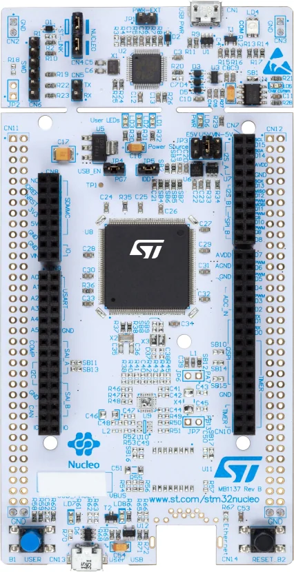

# nucleo-f413 - STM32F413ZHT6 Nucleo-144 development projects

Bare-metal projects for the **nucleo-f413** board (Nucleo-144 with
STM32F413ZHT6), built with **CMake/Ninja** (Pico-style), debugged and
flashed through the onboard **ST-Link** over **SWD**, with `printf()`
streamed out **USART3 (PD8/PD9)** at 115200 baud - the ST-LINK
**virtual COM port (VCP)** is the console.

## Board facts

- MCU: STM32F413ZHT6 (Cortex-M4F @ up to 100 MHz, 1.5 MB flash, 320 KB SRAM) - **runs at its 100 MHz maximum**
- Clock: **HSI 16 MHz -> PLL -> 100 MHz** (M=16/N=200/P=2; AHB=100,
  APB1=50, APB2=100; PLLQ=5 keeps the 40 MHz kernel clock inside the
  48 MHz limit - Q=4 would give 50 MHz and HAL rejects the config)
- LEDs: **LD1=PB0** (green), **LD2=PB7** (blue), **LD3=PB14** (red) -
  all **high-active** (pin SET = on)
- Button: USER B1 = PC13, pressed = high
- Console: **USART3 PD8 (TX) / PD9 (RX)**, 115200 8-N-1 - ST-LINK VCP
- Debug: onboard ST-Link over SWD; probe-rs auto-detects it

## Projects (`app/`)

| Project                 | What it does |
| ----------------------- | ------------ |
| `app/blink_hello`       | Blinks the three user LEDs and periodically prints the ADC1 internal channels (temperature / VREFINT / VBAT) |
| `app/dhry_100m`         | Dhrystone 2.1 @ 100 MHz: **235.2k Dhrystones/s = 1.339 DMIPS/MHz** (GCC -Ofast -funroll-loops) |
| `app/coremark_100m`     | CoreMark 1.0.1 @ 100 MHz: **282.32 it/s** (GCC -Ofast -funroll-all-loops, crc 0x988c validated) |

## Notes

- The board layer lives in `board/` (clock init, LEDs, USART3 printf,
  startup, linker script) and is attached to projects by
  `cmake/stm32f413_board.cmake` (`stm32f413_apply_board()`).
- `flash-targets.cmake` programs the chip with probe-rs
  (`--chip STM32F413ZH`) or OpenOCD (`openocd_stm32f413zh.cfg`).
- Board photographs: [`board_images/`](board_images) (referenced above).
